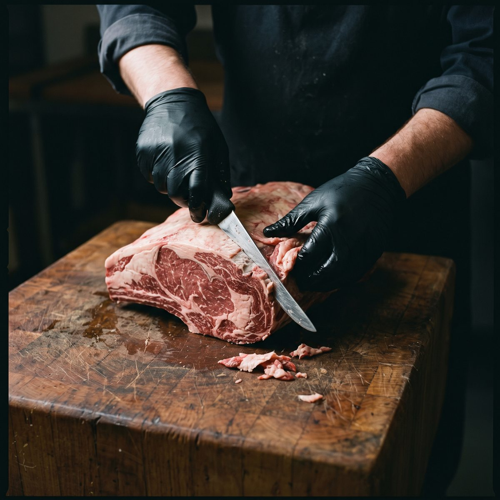

# Efeler Toptan Et — tanıtım sitesi

Tek sayfalık tanıtım sitesi. Saf HTML, CSS ve JavaScript; derleme adımı, npm paketi ya da framework yok.

```
index.html            ana sayfanın tamamı
404.html              "Sayfa bulunamadı" sayfası (GitHub Pages olmayan adreslerde kendiliğinden gösterir)
kvkk.html             KVKK aydınlatma metni şablonu (metin firmadan gelecek)
robots.txt            arama motoru kuralları   ┐ alan adı günü doldurulacak
sitemap.xml           site haritası            ┘ (ALANADI yer tutucusu)
_config.yml           GitHub Pages ayarı: README ve çalışma dosyaları sitede yayınlanmaz
CLAUDE.md             yapay zekâ yardımcısı için kısa kural ve bağlam dosyası (sitede yayınlanmaz)
assets/css/style.css  bütün stiller (renkler ve ölçüler en üstte, :root altında)
assets/js/main.js     firma bilgileri (SITE nesnesi) ve sayfa davranışları
assets/js/ilk.js      ilk boyamadan önce: tema seçimi ve çerçeve koruması (her sayfada)
assets/js/acilis.js   açılış perdesi (yalnız ana sayfada)
assets/img/           logo, ikonlar, fotoğraflar, paylaşım görseli
assets/fonts/         sitede gömülü yazı tipleri (woff2) ve lisansları
```

`referans/` ve `PROMPT.md` çalışma dosyalarıdır; GitHub'a yüklemeyin (bkz. "Yayın günü kontrol listesi"). **Depo herkese açıksa, GitHub'a yüklenen her dosya github.com'da herkes tarafından okunabilir.** `_config.yml` yalnızca bu dosyaların sitenin adresinden açılmasını engeller.

## Siteyi açma

- **Bilgisayarda:** `index.html` dosyasına çift tıklayın. Yazı tipleri sitenin içinde olduğu için internet bağlantısı gerekmez.
- **GitHub Pages:** Depoda *Settings → Pages* altında yayın dalını seçin. Bütün yollar göreli olduğu için site alt klasörden (`kullanici.github.io/depo-adi/`) de sorunsuz çalışır.

## Firma bilgilerini girme

Telefon, adres gibi bilgiler `assets/js/main.js` dosyasının başındaki `SITE` nesnesinden değiştirilir:

```js
const SITE = {
  unvan: 'Efeler Et Gıda San. ve Tic. Ltd. Şti.',
  telefon: '0530 342 25 40',
  whatsapp: '905303422540',
  eposta: '',
  ...
};
```

`eposta`, `instagram` ve `facebook` boş kaldıkça alt bilgide **gizli** durur, ziyaretçi boş bağlantı görmez. Doldurulunca kendiliğinden görünür; ilgili her yerde metin ve bağlantı birlikte güncellenir. Instagram ve Facebook adresi `https://` ile başlamıyorsa güvenlik gereği bağlantı kurulmaz.

**Bilgiler iki yerde yazılı.** Aynı bilgiler `index.html`'de de düz metin ve bağlantı olarak duruyor; JavaScript'i kapalı tarayıcılar onları gösterir. JavaScript açıkken `SITE`'taki değer geçerlidir. Bir bilgi değişince ikisini birlikte değiştirin: `index.html`'de Ctrl+F ile eski değeri (ör. `0530 342 25 40`) arayıp hepsini değiştirin. Bağlantılarda numara boşluksuz ve `90` ile yazılıdır (`tel:+905303422540`, `wa.me/905303422540`); onları da aratın.

| Alan | Nasıl yazılır | Sayfada nerede |
|---|---|---|
| `unvan` | Olduğu gibi | Alt bilginin en altındaki © satırı |
| `telefon` | Görünmesini istediğiniz biçimde: `0530 342 25 40` | Üst şerit, teklif bölümündeki buton. Tıklayınca arama açılır; bağlantı `+90` ile kurulur (`tel:+905303422540`). |
| `whatsapp` | Ülke kodlu, yalnız rakam: `90` ile başlar, başta `+` ya da `0` yok | Üst şerit, "WHATSAPP'TAN YAZ", sağ alttaki yuvarlak buton, teklif formu |
| `eposta` | `ad@alanadi.com` | Alt bilgi (`mailto:` bağlantısı) |
| `adres` | Olduğu gibi; ilçe ve il son virgülden sonra | Alt bilgi, son virgülden iki satıra bölünerek. Altındaki "Yol tarifi →" bu adresi Google Haritalar'da yeni sekmede açar. |
| `yetkililer` | Her kişi bir satır: `{ ad: '…', telefon: '…' }`. Satır ekleyip silebilirsiniz. | Alt bilgi: ad ve altında tıklanabilir telefon |
| `sehir` | Olduğu gibi; büyük harfe kendisi çevrilir | Kapaktaki "TOPTAN ET TEDARİKÇİSİ · İSTANBUL" |
| `calismaSaatleri` | Olduğu gibi: `06:00 – 17:00` | Üst şerit (büyük harfle) ve alt bilgi (yazıldığı gibi) |
| `instagram`, `facebook` | `https://` ile başlayan tam adres | Alt bilginin en altındaki bağlantılar |

Büyük harf dönüşümü Türkçe kurala göre yapılır (`izmir` → `İZMİR`).

**WhatsApp:** Butonlar sohbeti "Merhaba, teklif almak istiyorum." cümlesiyle açar. Teklif formu da doğrulamadan sonra doldurulan bilgileri okunaklı bir mesaj hâlinde WhatsApp'a gönderir. Numara silinirse form hiçbir yere gitmez; altında "WhatsApp numarası eklenince bu form doğrudan mesaj olarak gidecek." yazar. Açılış cümlesi `main.js` içindeki `WA_SELAM` sabitinden değiştirilebilir.

HTML tarafında bu bağlantıyı iki işaret kurar: `data-site="telefon"` metni değiştirir, `data-site-href="telefon"` bağlantıyı kurar. Yeni bir yere telefon eklemek isterseniz aynı işaretleri kullanın. Yetkililer listesini `data-yetkililer` işaretli liste gösterir.

## Logo

Logo dosyaları `assets/img/` içinde. Sitede SVG'ler kullanılır; PNG'ler başka yerlerde (sosyal medya, belge) kullanmak için.

| Dosya | Ne | Sitede nerede |
|---|---|---|
| `efeler-amblem.svg` (+ `.png`) | Renkli amblem (boğa + satırlar), açık zemin için. 941×755 | Menü (açık temada), kapaktaki eğik çıkartma |
| `efeler-amblem-koyu.svg` (+ `.png`) | Amblem, satırlar beyaz; koyu zemin için | Menü (karanlık temada) |
| `efeler-amblem-beyaz.svg` (+ `.png`) | Tek renk beyaz amblem; kırmızı zemin için | Sitede kullanılmıyor |
| `efeler-logo-ilk.svg` (+ `.png`) | İlk logo: şeridinde EFELER / ET GIDA, beyaz çerçeveli çıkartma görünümü. 1513×1459 | Açılış perdesi. Dosya yolu `assets/js/acilis.js` içindeki `LOGO` satırında. |
| `efeler-logo.svg` | Amblem + EFELER / TOPTAN ET, açık zemin. 1081×1315 | Sitede kullanılmıyor |
| `efeler-logo-koyu.svg` (+ `.png`) | Aynısı, koyu zemin | Alt bilgideki büyük logo |
| `efeler-logo-beyaz.svg` (+ `.png`) | Aynısı, tek renk beyaz | Sitede kullanılmıyor |
| `efeler-logo.png` | Açık zemin logosu, 1200×1460, şeffaf zemin | Sitede kullanılmıyor |
| `og-gorsel.jpg` | Paylaşım görseli, 1200×630: koyu zeminde logo, "TOPTAN ET, USTA İŞİ KESİM." ve kırmızı ürün şeridi | WhatsApp, Facebook, X'te bağlantı paylaşılınca çıkan önizleme (`og:image`) |
| `favicon-32.png`, `apple-touch-icon.png` | Site ikonları | Tarayıcı sekmesi, telefonda ana ekran |

- Logonun alt metni her yerde "Efeler Toptan Et logosu". Kapaktaki çıkartma süs olduğu için `alt=""` (menüdeki logo zaten okunuyor).
- ``'lerdeki `width` ve `height` dosyanın kendi oranıdır (amblem 941×755, logo 1081×1315); ekrandaki boyutu CSS belirler. Logo dosyası değişirse bu iki sayıyı yeni dosyanın oranına göre güncelleyin, yoksa logo ezilebilir.
- Menüdeki iki amblemden hangisinin görüneceğini tema belirler (`only-light` / `only-dark` sınıfları); görünmeyen dosya hiç indirilmez.
- Kapaktaki çıkartmanın beyaz kesim konturu dosyada değil, CSS'te (`.hero__sticker`): amblemin koyu satırları fotoğrafın ve koyu temanın üstünde de seçilsin diye.

## Fotoğraf ekleme

Her fotoğraf alanı sabit oranlı bir kutudur. İçine `` konunca resim kutuyu doldurur; çizgili yer tutucu ve etiketi kendiliğinden kaybolur. Kutunun boyunu ya da tasarımı ayrıca değiştirmeniz gerekmez.

### Dosya adı kuralı

- Küçük harf, Türkçe karakter yok, boşluk yerine tire: `dana-antrikot.jpg` (`Dana Antrikot.JPG` değil).
- Fotoğraflar `.jpg`, logolar şeffaf zeminli `.png` ya da `.svg`.
- Yüklemeden önce boyutu küçültün: fotoğraflarda uzun kenar 1600 px yeterli, dosya başına 300 KB altı hedefleyin. Hiçbir dosya 400 KB'ı geçmesin.
- **Yüklemeden önce konum bilgisini temizleyin.** Telefonla çekilen fotoğrafların içinde çekildiği yerin GPS konumu, tarih ve telefon modeli saklı olabilir; siteye konan fotoğrafı indiren herkes bunu okuyabilir. Windows'ta: dosyaya sağ tıklayın → *Özellikler* → *Ayrıntılar* → en alttaki *Özellikleri ve Kişisel Bilgileri Kaldır* → *Tüm olası özellikleri kaldırılmış bir kopya oluştur* → *Tamam*. Oluşan kopyayı yükleyin. (Sitedeki mevcut fotoğrafların hepsi kontrol edildi, hiçbirinde konum ya da kişisel bilgi yok.)

| Ne | Klasör ve ad | Oran / en az boyut |
|---|---|---|
| Kapak fotoğrafı | `assets/img/kapak.jpg` | Kare, en az 1200×1200 (daireye kırpılır) |
| Ürünler | `assets/img/urun/` içinde; aşağıdaki "Ürünler" bölümüne bakın | 4:5, örn. 1200×1500 |
| Belge taramaları | `assets/img/belge/helal.jpg`, `iso-22000.jpg`, `haccp.jpg`, `isletme-onay.jpg` | 3:4, örn. 1500×2000 |
| Belge PDF'leri | `assets/belge/helal.pdf` vb. | — |

### Kapak

`index.html` içinde `KAPAK FOTOĞRAFI` etiketinin hemen altındaki yorum satırını açın:

```html

```

Kapak fotoğrafına `loading="lazy"` **eklemeyin**; ilk ekranda görünmesi gerekir.

## Ürünler

Ürünler bölümündeki dört sekme (DANA, KUZU, TAVUK, KÖFTE & DÖNER) `index.html` içindeki ürün listesinden oluşur. Satırlardaki 01, 02 … numaraları ve sekmenin yanındaki ürün sayısı kendiliğinden hesaplanır, elle yazmayın.

**Sitede fiyat yazmayın.** Firma sitede fiyat göstermek istemiyor; ürün adının yanına fiyat, ₺ ya da "uygun fiyat" gibi bir ifade eklemeyin.

### Ürün ekleme ve çıkarma

1. `index.html` dosyasını bir metin düzenleyiciyle açın. Not Defteri yeterli; Word kullanmayın.
2. Ctrl+F ile listedeki bir ürünün adını arayın, örneğin `KUZU ŞİŞ`. Her ürün tek bir satırdır:

   ```html
   <li>KUZU ŞİŞ</li>
   <li>KUZU LOKUM</li>
   ```

3. **Ürün eklemek:** Bir satırı kopyalayıp istediğiniz yere yapıştırın, sonra adını değiştirin:

   ```html
   <li>KUZU ŞİŞ</li>
   <li>YENİ ÜRÜNÜN ADI</li>
   <li>KUZU LOKUM</li>
   ```

   Adı BÜYÜK HARFLE ve Türkçe harflerle yazın (İ, Ş, Ğ, Ü, Ö, Ç). Baştaki `<li>` ve sondaki `</li>` silinmemeli.
4. **Ürün çıkarmak:** Ürünün satırını baştan sona silin.
5. **Sırayı değiştirmek:** Satırı kesip (Ctrl+X) yeni yerine yapıştırın (Ctrl+V).
6. Kaydedin. Not Defteri kaydederken kodlamayı soruyorsa "UTF-8" seçili kalsın, yoksa Türkçe harfler bozulur. Dosyayı tarayıcıda açıp bakın, sonra `index.html`'i GitHub'a yükleyin.

Ürün hangi grubun listesine yazılırsa o sekmede görünür. Her grubun başında adı yazar (örneğin `<h3 class="prod-panel__title">KUZU</h3>`); yeni satırı o grubun `<ol class="prod-list">` ile `</ol>` satırları arasına koyun.

### Bir ürüne fotoğraf bağlama

1. Fotoğrafı hazırlayın: dikey, 4:5 oranında (örneğin 1200×1500 piksel), `.jpg`, mümkünse 300 KB'tan küçük.
2. Dosyaya kurala uygun bir ad verin: küçük harf, Türkçe harf yok, boşluk yerine tire. Örneğin KIVIRCIK KUZU PİRZOLA için `kuzu-pirzola.jpg`.
3. Dosyayı GitHub'da `assets/img/urun/` klasörüne yükleyin.
4. `index.html`'de ürünün satırını bulun ve `<li` ile `>` arasına fotoğrafın yerini yazın:

   Önce:

   ```html
   <li>KIVIRCIK KUZU PİRZOLA</li>
   ```

   Sonra:

   ```html
   <li data-foto="assets/img/urun/kuzu-pirzola.jpg">KIVIRCIK KUZU PİRZOLA</li>
   ```

5. Kaydedip `index.html`'i yükleyin.

Ziyaretçi o ürünün üzerine gelince, dokununca ya da klavyeyle seçince fotoğraf yumuşak bir geçişle o ürünün fotoğrafına döner. Fotoğrafı olmayan üründe grubun kapak fotoğrafı görünür, yalnızca satır vurgulanır. Dosya adını yanlış yazarsanız ya da dosyayı yüklemeyi unutursanız sayfa bozulmaz, kapak fotoğrafı görünmeye devam eder. Bağlantıyı kaldırmak için `data-foto="…"` kısmını silin.

### Grubun kapak fotoğrafı

Her grubun solda (telefonda üstte) duran bir kapak fotoğrafı var:

| Grup | Dosya |
|---|---|
| DANA | `assets/img/urun/dana-antrikot.jpg` |
| KUZU | `assets/img/urun/kuzu-karkas.jpg` |
| TAVUK | `assets/img/urun/tavuk-kapak.jpg` |
| KÖFTE & DÖNER | `assets/img/urun/kofte-doner-kapak.jpg` |

Bir kapağı değiştirmek için yeni dosyayı **tam aynı adla** `assets/img/urun/` klasörüne yüklemeniz yeter, `index.html`'e dokunmanız gerekmez. Dosya bir gün eksik kalırsa yerinde "[TAVUK FOTOĞRAFI]" gibi bir yer tutucu görünür.

Şu an fotoğrafı olmayan tek ürün KUZU KASKİ.

`dana-karkas.jpg` artık sayfada kullanılmıyor, yalnızca klasörde duruyor.

Ürün fotoğraflarının `alt` metni bilerek boş: ürünün adı fotoğrafın hemen yanında yazılı.

## Belgeler

Her belge bir `<article class="doc">` bloğudur:

```html
<article class="doc" data-src="assets/img/belge/helal.jpg" data-pdf="assets/belge/helal.pdf">
  <div class="ph doc__scan">
    …
    
    <span class="doc__badge" aria-hidden="true"></span>
  </div>
  <h3 class="doc__title">HELAL BELGESİ</h3>
  <dl class="doc__meta"> … [KURUM] … [NO] … [TARİH] … </dl>
  <button class="doc__open" type="button">Belgeyi görüntüle →</button>
</article>
```

- **Kartın içindeki ``** kartta görünen küçük hâldir. Belgede bir yorum satırı örnek olarak duruyor.
- **`data-src`** karta ya da "Belgeyi görüntüle"ye tıklayınca açılan büyük görünümdür. Boşsa pencerede yer tutucu ve belge adı görünür.
- **`data-pdf`** doluysa pencerede "PDF OLARAK İNDİR" bağlantısı çıkar.
- **Kurum, belge no, geçerlilik** bilgileri doğrudan HTML'de, `[KURUM]` / `[NO]` / `[TARİH]` yerine yazılır.
- **Kart eklemek** için bir `<article class="doc">…</article>` bloğunu kopyalayın; **çıkarmak** için silin. Sağ üstteki sıra numarası (01, 02 …) ve kartların farklı eğimleri kendiliğinden gelir.
- Belge adları büyük harfle yazılır (`İŞLETME ONAY BELGESİ`). CSS büyük harfe çevirmez; çevirseydi tarayıcı dili yanlış algılandığında "i" harfi "I" olurdu.

## Sertifikaları geri açma

Sertifikalar bölümü belgeler gelene kadar **geçici olarak gizli**. Kodu silinmedi; üç yerde `hidden` yazısı onu saklıyor. Her birinin üstünde şu yorum satırı var, `index.html`'de Ctrl+F ile aratıp bulabilirsiniz:

```html
<!-- SERTİFİKALAR GEÇİCİ OLARAK GİZLİ — belgeler gelince açılacak ... -->
```

**1. Üç `hidden`'ı silin** (yalnız bu kelimeyi; satırın geri kalanı kalsın):

| Nerede | Şu an | Olacak |
|---|---|---|
| Menü (telefondaki menü de aynısı) | `<a class="nav__link" href="#sertifikalar" hidden>Sertifikalar</a>` | `<a class="nav__link" href="#sertifikalar">Sertifikalar</a>` |
| Bölümün kendisi | `<section class="section section--muted sertifikalar" id="sertifikalar" aria-labelledby="sertifikalar-baslik" hidden>` | aynı satır, sondaki ` hidden` olmadan |
| Alt bilgi | `<a class="foot-link" href="#sertifikalar" hidden>Sertifikalar</a>` | `<a class="foot-link" href="#sertifikalar">Sertifikalar</a>` |

Belge penceresindeki `PDF OLARAK İNDİR` satırında da `hidden` var; **ona dokunmayın**, o ayrı bir şey (PDF yoksa düğme gizli kalır).

**2. Numarayı düzeltin.** Teklif bölümünün etiketi şu an `05 — TEKLİF AL`. Ctrl+F ile `05 — TEKLİF AL` aratıp `06 — TEKLİF AL` yapın (üstündeki `<!-- 05 TEKLİF ... -->` yorumunu da `06` yapabilirsiniz). Sertifikaların kendi etiketi zaten `05 — SERTİFİKALAR`; değiştirmeyin.

**3. Belge görsellerini koyun.** Taramaları `assets/img/belge/` klasörüne yükleyin (örn. `helal.jpg`, `iso-22000.jpg`, `haccp.jpg`, `isletme-onay.jpg`; 3:4, örn. 1500×2000), PDF'leri `assets/belge/` klasörüne. Sonra her belge kartını yukarıdaki "Belgeler" bölümünde anlatıldığı gibi doldurun: kartın içindeki ``, `data-src`, `data-pdf`, veren kurum, belge no, geçerlilik. Belgelerin adı ya da sayısı farklıysa kart ekleyip çıkarabilirsiniz.

**4. Kontrol.** Sayfayı açın: menüde ve alt bilgide "Sertifikalar" görünmeli, bölüm Süreç'ten sonra gelmeli, bir karta tıklayınca belge büyük açılmalı. JavaScript'te bir şey değiştirmeniz gerekmez; belge penceresi bölüm görünür olunca kendiliğinden çalışır.

## Renkler ve yazı tipleri

Bütün renkler `style.css` başında `:root` altında değişken olarak tanımlı (`--red`, `--ink` …). Bir rengi değiştirmek için yalnızca oradaki değeri değiştirin. Bileşenlerin bu renklere nasıl bağlandığı aşağıdaki "Aydınlık / karanlık tema" bölümünde.

İki kırmızı bilerek var:
- `--red` (logo kırmızısı) büyük ve kalın yazılarda, butonlarda ve grafiklerde kullanılır.
- `--red-deep` üzerinde küçük beyaz yazı olan zeminlerde ve açık zemindeki küçük kırmızı yazılarda kullanılır. Küçük yazı `--red` üzerinde okunaklı olmaz.

**Yazı tipleri** sitenin içinde, `assets/fonts/` klasöründe (Google Fonts'a bağlanılmaz):

| Yazı tipi | Kalınlık | Dosyalar | Nerede |
|---|---|---|---|
| Big Shoulders Display | 700–900 (tek değişken dosya) | `big-shoulders-display-latin.woff2`, `-latin-ext.woff2` | Başlıklar, butonlar, ürün adları |
| Hanken Grotesk | 400–700 (tek değişken dosya) | `hanken-grotesk-latin.woff2`, `-latin-ext.woff2` | Metin |
| IBM Plex Mono | 400, 500, 600 | `ibm-plex-mono-400-latin.woff2` … `-600-latin-ext.woff2` | Etiketler, numaralar |

- Her yazı tipinin iki parçası var: `latin` (Ü, Ö, Ç, ı dahil) ve `latin-ext` (İ, Ş, Ğ). Tarayıcı ikinci parçayı yalnızca sayfada o harfler varsa indirir. İkisini de silmeyin.
- `@font-face` kuralları `style.css`'in en başında; kapakta ilk görünen dosyalar (Big Shoulders Display ve Hanken Grotesk) `index.html` başında `<link rel="preload">` ile önceden yüklenir.
- Açılış perdesi yazı tipleri hazır olunca açılır (en geç 4 sn). Perdenin gösterilmediği açılışlarda sayfa, kapak yazı tipleri hazır olana kadar en çok 300 ms görünmez kalır; böylece yazı bir anlığına başka yazı tipiyle görünmez.
- Lisans: üçü de SIL Open Font License; metinleri `OFL-*.txt` dosyalarında, yazı tipleriyle birlikte yayında kalmalı.

## Aydınlık / karanlık tema

Menüde TEKLİF AL'ın solundaki güneş/ay butonu iki tema arasında geçirir.

- **Aydınlık:** bütün bölümler açık zeminli; zeminler `--paper`, `--white` ve `--stone` arasında değişir.
- **Karanlık:** bütün bölümler koyu zeminli; zeminler `--ink`, `--night-1` (#20211C) ve `--night-2` (#262721) arasında değişir.
- **İki temada aynı kalanlar:** üst bilgi şeridi, kayan kırmızı şerit, teklif bölümünün kırmızı zemini, alt bilgi, kapaktaki logo çıkartması, dönen damga ve açılış perdesi. Menüdeki amblem temaya göre değişir (açık zeminde renkli, koyu zeminde beyaz satırlı).

**Hangi tema açılır:** Ziyaretçi butona bastıysa seçimi tarayıcıda (`localStorage`, `efeler-tema` anahtarı) saklanır ve sonraki ziyarette o tema açılır. Seçim yoksa cihazın açık/koyu ayarı geçerlidir; cihaz ayarı değişince sayfa da onu izler. Seçim `index.html` başındaki kısa betikle ilk boyamadan önce yapılır, sayfa bir an yanlış renkte görünmez. JavaScript kapalıyken tema cihaz ayarından gelir, buton gizlenir.

**Renk nasıl değiştirilir:** Bileşenler doğrudan renk değil, anlamsal değişken kullanır. `style.css` başındaki tema bloklarında her değişkenin iki temadaki değeri yazılı:

| Değişken | Anlamı |
|---|---|
| `--bg`, `--bg-alt`, `--bg-muted` | Bölüm zeminleri (A, B, C rolleri) |
| `--surface` | Belge kartı, form kutusu, belge penceresi |
| `--text`, `--text-2`, `--text-3` | Ana metin, ikincil paragraf, etiket ve künye |
| `--line-soft` | İnce çizgiler |
| `--hatch-a/b`, `--doc-hatch-a/b`, `--ph-text` | Fotoğraf ve belge yer tutucuları |
| `--field-bg`, `--field-border` | Form alanları |
| `--cut-part`, `--cut-back`, `--cut-badge`, `--cut-row` | Kesim şeması |
| `--accent-large`, `--link-small`, `--link-line`, `--danger-text` | Kırmızı vurgular, küçük bağlantılar, hata metni |

Karanlık tema değerleri iki yerde yazılıdır: cihaz ayarı için `@media (prefers-color-scheme: dark)` bloğunda ve butonla seçim için `:root[data-theme="dark"]` bloğunda. Bir değeri değiştirirken ikisini birlikte değiştirin.

Bölüm zeminleri HTML'deki sınıflardan gelir: sınıf yoksa A, `section--alt` B, `section--muted` C.

**Kontrast:** Normal metinler iki temada da en az 4.5:1, büyük başlıklar en az 3:1. Koyu zeminde küçük kırmızı yazı kullanılmaz: "Belgeyi görüntüle" karanlık temada beyazdır, kırmızı yalnızca alt çizgide kalır. Hata mesajları karanlık temada açık kırmızımsı bir tondadır (`--red-soft`).

## Sayfadaki davranışlar

- **Açılış perdesi:** Sayfa açılırken ekranı kırmızı bir perde kaplar, ortasında ilk logo (`efeler-logo-ilk.svg`, EFELER / ET GIDA şeritli) belirir (0.4 sn). Sayfa yüklenince ve logo en az 0.8 sn tam göründükten sonra perde ortadan ikiye bölünüp iki yana açılır (0.9 sn); logo sol yarının kenarına yapışık, onunla tek parça çıkar. Logonun genişliği `style.css`'teki `--splash-logo` değişkeninde: `min(52vw, 300px)`. Kapak başlığı ve görseli bu sırada belirir. Perde aynı sekmede oturum boyunca bir kez gösterilir (`sessionStorage`, `efeler-acilis` anahtarı); sayfa yenilense de tekrar çıkmaz, yeni sekmede çıkar. Perde açıkken sayfa kaydırılamaz; açılınca sayfadan tamamen kaldırılır.
  - Davranış `assets/js/acilis.js` dosyasında, `main.js`'ten bağımsızdır: `main.js` yüklenmese ya da hata verse de çalışır. Sayfa 4 saniyede yüklenmezse ya da betikte hata olursa perde yine açılır. JavaScript kapalıysa perde hiç görünmez.
  - Süreler `acilis.js`'teki `HOLD` (1200 ms: 0.4 sn beliriş + 0.8 sn bekleme) ve `LIMIT` (4000 ms) sabitlerinde, hareketler `style.css`'teki "Açılış perdesi" bölümünde.
  - Perdeyi yeniden görmek için tarayıcıda yeni bir sekmede açın.
- **Yapışkan menü:** Sayfa kayınca üstte kalır ve küçülür; üst bilgi şeridi kayıp gider.
- **Mobil menü:** 900 px altında bağlantılar hamburger butonun arkasına girer. Esc, bağlantıya tıklama ya da dışarı tıklama paneli kapatır.
- **Kesim şeması:** Parçanın ya da listedeki satırın üzerine gelince ikisi birlikte vurgulanır. Dokunmatik ekranda dokununca, klavyede odaklanınca seçili kalır.
- **Ürün sekmeleri:** Sekmeye tıklayınca ya da dokununca grup değişir. Klavyede sol/sağ ok, Home ve End sekmeler arasında gezer, Tab ürün listesine geçer. Dar ekranda sekme çubuğu yana kayar. JavaScript kapalıyken dört grup alt alta açık durur.
- **Ürün fotoğrafı:** Fotoğraflı ürünün üzerine gelince fotoğraf o ürüne döner; dokununca, tıklayınca ya da klavyeyle odaklanınca seçili kalır. Fotoğraf kaydırırken yerinde kalır (telefonda menünün hemen altında), böylece listenin altındaki ürüne dokununca da görünür. "FİYAT İÇİN LİSTENİZİ GÖNDERİN →" notu açık listenin altında durur.
  - Ürün fotoğrafları sayfa açılırken inmez (yalnızca grubun kapak fotoğrafı iner). Fare listeye girince o grubun fotoğrafları, telefonda dokunulan ürünün fotoğrafı iner; inene kadar önceki fotoğraf görünür. Böylece telefonda sayfa megabaytlarca gereksiz fotoğraf indirmez.
- **Belge penceresi:** Esc, dışına tıklama ya da kapat butonu kapatır. Sertifikalar bölümü gizliyken kurulmaz.
- **Teklif formu:** İşletme adı, telefon ve ürün-miktar zorunludur. Hatalar alanın altında Türkçe gösterilir.
  - Karakter sınırı: işletme 80, yetkili 60, telefon 20, ürün ve miktar 1000. Telefonda yalnızca rakam, boşluk ve baştaki + kabul edilir.
  - Form hiçbir sunucuya veri göndermez, hiçbir yerde saklamaz: bilgilerden bir mesaj kurar ve yalnızca WhatsApp'ı açar. Mesajı gönderen yine ziyaretçinin kendisidir.
  - JavaScript kapalı tarayıcıda form gizlenir (çalışamaz, bilgiler adres çubuğuna düşerdi); "WHATSAPP'TAN YAZ" ve telefon butonları görünür kalır.
- **Sabit WhatsApp butonu:** Kapak geçilince sağ altta belirir, teklif bölümü ekrandayken gizlenir.
- **Kaydırınca belirme:** Başlıklar ve kartlar ekrana girerken bir kez hafifçe belirir.

Ziyaretçinin cihazında "hareketi azalt" ayarı açıksa kayan şerit, dönen damga, belirme ve geçişlerin hepsi kapanır; ürün fotoğrafı da geçişsiz, anında değişir. Açılış perdesi bölünüp kaymaz, 0.3 sn'de solarak kaybolur. JavaScript kapalıyken de sayfa görünür (teklif formu hariç); menü bağlantıları alt satıra sarılır.

## Güvenlik ayarları

GitHub Pages'te sunucu ayarı (HTTP başlığı) yapılamadığı için güvenlik ayarları sayfaların içinde:

- **İçerik güvenlik politikası (CSP):** `index.html`, `404.html` ve `kvkk.html` başındaki `Content-Security-Policy` satırı, sayfanın yalnızca kendi dosyalarını (betik, stil, yazı tipi, görsel) yüklemesine izin verir. Biri sayfaya kötü niyetli bir betik sokmayı başarsa bile çalışmaz.
  - Bu yüzden **HTML'e satır içi `<script>…</script>`, `style="…"` ya da `onclick="…"` yazmayın**; çalışmaz. Betik `assets/js/` içine, stil `style.css`'e yazılır.
  - İleride dışarıdan bir şey eklenirse (Google Haritalar penceresi, ziyaretçi sayacı, takip kodu, YouTube videosu), o adresin bu satıra eklenmesi gerekir; yoksa sessizce çalışmaz. Bunu bir geliştiriciye yaptırın.
  - Bağlantılar (WhatsApp, Google Haritalar'da yol tarifi, Instagram) bu kurala takılmaz; yeni sekmede açılırlar.
- **Yönlendiren bilgisi:** `referrer` satırı, ziyaretçi WhatsApp'a ya da haritaya geçerken karşı siteye yalnızca alan adını söyler, sayfa adresinin tamamını değil. Yeni sekmede açılan bütün bağlantılarda `rel="noopener noreferrer"` var.
- **Çerçeve koruması (clickjacking):** Başka bir site bu sayfayı kendi sayfasının içine (iframe) gömerse `ilk.js` sayfayı gizler, yerine "Efeler Toptan Et sitesini açmak için dokunun →" yazan kırmızı bir ekran gösterir; dokununca site kendi penceresinde açılır. Not: bazı kod düzenleyicilerin önizleme paneli de sayfayı çerçeve içinde açar; orada bu ekranı görmeniz normaldir, sayfayı tarayıcıda açın.
- **Tarayıcıda saklananlar:** Yalnızca iki kayıt: seçilen tema (`efeler-tema`) ve açılış perdesinin bu sekmede gösterildiği (`efeler-acilis`). Çerez yok, kişisel veri yok, formdaki bilgiler hiçbir yerde saklanmaz.
- **Dış kaynak yok:** Sayfa başka hiçbir siteden betik, yazı tipi, görsel ya da takip kodu yüklemez.

## Gizli bekleyenler

İçeriği henüz gelmeyen her şey sayfada **gizli** (`hidden`) duruyor; boş bağlantı görünmüyor. Her birinin üstünde `GEÇİCİ OLARAK GİZLİ` yazan bir yorum satırı var; `index.html`'de Ctrl+F ile `GEÇİCİ OLARAK GİZLİ` aratınca hepsini bulursunuz.

| Ne | Nerede | Açmak için |
|---|---|---|
| Sertifikalar (bölüm, menü ve alt bilgi bağlantısı) | `index.html` | "Sertifikaları geri açma" bölümü |
| KVKK (formun altındaki not ve alt bilgideki bağlantı) | `index.html` | "KVKK'yı açma" bölümü |
| Hakkımızda bağlantısı | `index.html`, alt bilgi, KURUMSAL | Hakkımızda metni gelince nereye gideceği belli olur; `href="#top"` yerine hedefi yazıp `hidden`'ı silin |
| E-posta | `index.html`, alt bilgi, İLETİŞİM | `main.js`'te `eposta: ''` doldurulunca kendiliğinden görünür. JavaScript kapalı tarayıcılar için `index.html`'de de `hidden`'ı silip `href="mailto:adres"` ekleyin, `[E-POSTA]` yerine adresi yazın. |
| Instagram, Facebook | `index.html`, alt bilginin en altı | `main.js`'te `instagram` / `facebook` doldurulunca kendiliğinden görünür. `index.html`'de de `hidden`'ı silip `href="#top"` yerine tam adresi yazın. |
| MERSİS no ve vergi dairesi | `index.html`, alt bilginin en altındaki © satırı | `[MERSİS NO]` ve `[VERGİ DAİRESİ]` yerine bilgileri yazıp aynı satırdaki `<span hidden>`'ı `<span>` yapın |

## KVKK'yı açma

KVKK aydınlatma metni firmadan (tercihen hukuk danışmanından) gelecek; metni kendiniz yazmayın.

1. `kvkk.html`'i açın. `[AYDINLATMA METNİ — firmadan gelecek]` satırını silip yerine metni yazın: her paragraf `<p>…</p>`, ara başlıklar `<h2>…</h2>`, maddeler `<ul><li>…</li></ul>`. Firma ünvanı, adres, telefon ve e-posta üstteki kutuda zaten var (`main.js`'teki `SITE`'tan gelir).
2. `index.html`'de Ctrl+F ile `KVKK NOTU GEÇİCİ OLARAK GİZLİ` aratın. Altındaki `<p class="quote-form__kvkk" hidden>` satırından ` hidden`'ı silin: formun altında "TEKLİF İSTE'ye bastığınızda bilgileriniz teklif amacıyla WhatsApp üzerinden firmamıza iletilir. Ayrıntılar: KVKK Aydınlatma Metni" notu görünür. (Not, sizin verdiğiniz metindeki "Gönder" yerine formdaki butonun adını kullanıyor.)
3. Ctrl+F ile `KVKK GEÇİCİ OLARAK GİZLİ` aratın; alttaki `<a class="bar-link" href="kvkk.html" hidden>KVKK</a>` satırından ` hidden`'ı silin.
4. `index.html` ve `kvkk.html`'i GitHub'a yükleyin.

## 404 sayfası

Ziyaretçi sitede olmayan bir adrese giderse (ör. yanlış yazılmış bir bağlantı) GitHub Pages `404.html`'i gösterir: logo, "SAYFA BULUNAMADI.", ana sayfaya dönüş ve TEKLİF AL butonları. Telefon ve ünvan `main.js`'teki `SITE`'tan gelir. Alan adı bağlanınca `404.html`'deki `<base href="/">` satırını açın (bkz. "Yayın günü kontrol listesi"); açılmazsa `/a/b/c` gibi derin hatalı adreslerde sayfa stilsiz görünür.

## Taslak yayını

Site şu an müşteri onayı için taslak olarak yayında. `index.html` başındaki şu satır arama motorlarının sayfayı dizine eklemesini ve bağlantıları izlemesini engelliyor:

```html
<meta name="robots" content="noindex, nofollow">
```

**Yayına çıkarken kaldırılacak.** Satır yerinde kalırsa site Google'da hiç görünmez.

## Doldurulmayı bekleyenler

**Firmadan beklenen bilgiler**

- [ ] E-posta adresi (`SITE.eposta` ve `index.html`'deki `[E-POSTA]`; bkz. "Gizli bekleyenler")
- [ ] Instagram adresi
- [ ] Facebook adresi
- [ ] Belge taramaları; her belge için gerçek adı, veren kurum, belge no, geçerlilik tarihi ve PDF (gelince Sertifikalar bölümü geri açılacak; bkz. "Sertifikaları geri açma")
- [ ] KVKK aydınlatma metni (bkz. "KVKK'yı açma")
- [ ] MERSİS numarası ve vergi dairesi
- [ ] Hakkımızda metni (ve nerede duracağı: ana sayfada bir bölüm mü, ayrı sayfa mı)
- [ ] Çalışma günleri (saatler belli: 06:00 – 17:00; günler gelince `calismaSaatleri` alanına eklenir)
- [ ] KUZU KASKİ fotoğrafı
- [ ] Gerçek ürün fotoğrafları (yüklemeden önce konum bilgisini temizleyin; bkz. "Dosya adı kuralı")

**Yayından önce**

- [ ] "TÜM BELGELER" butonunun hedefi (Sertifikalar açılınca; şimdilik aynı bölüme gidiyor)
- [ ] Bütün metinlerin firmayla gözden geçirilmesi. Süreç bölümündeki "Besiciden seçilen dana ve kuzu." cümlesi tavuğu kapsamıyor; firmayla netleştirilmeli.
- [ ] Alan adı günü: aşağıdaki "Yayın günü kontrol listesi"

## Yayın günü kontrol listesi

Alan adı bağlanacağı gün, sırayla. Örneklerdeki `alanadiniz.com` yer tutucudur; yerine kendi alan adınızı yazın. Alan adını her yere `https://` ile ve başında `www.` olup olmadığına dikkat ederek, GitHub'da ayarladığınızla aynı biçimde yazın.

**1. GitHub'a yüklenmeyecekler** — Depoda varsa silin (depo herkese açıksa herkes okuyabilir):
- [ ] `PROMPT.md` ve `referans/` klasörü (çalışma dosyaları)
- [ ] `.env`, `.bak`, `.old`, `~` ile biten yedekler, `Thumbs.db`, `desktop.ini` gibi sistem dosyaları (şu an klasörde yok; ileride oluşursa)
- [ ] Fiyat listesi, Excel/CSV, sözleşme gibi firma içi belgeler

**2. Alan adını bağlayın**
- [ ] GitHub'da depo → *Settings → Pages → Custom domain* kutusuna alan adını yazıp *Save*. (GitHub depoya `CNAME` adlı bir dosya ekler; silmeyin.)
- [ ] Alan adını aldığınız firmanın panelinde GitHub'ın gösterdiği DNS kayıtlarını girin. Yayılması birkaç saat sürebilir.
- [ ] Aynı sayfada **Enforce HTTPS** kutusunu işaretleyin (kutu ancak DNS yayıldıktan sonra açılır). Bu adım şart: CSP ve güvenli bağlantı buna dayanır.

**3. `ALANADI` yer tutucularını doldurun** — Ctrl+F ile `ALANADI` aratın, her yerde alan adını yazın:
- [ ] `index.html`: `ALAN ADI GÜNÜ` yazan yorumun altındaki dört satırı (`canonical`, `og:url`, `og:image`, `twitter:image`) yorumdan çıkarın: önlerindeki `<!-- … README: "Yayın günü kontrol listesi"` satırını ve sondaki `-->` satırını silin. Sonra hemen üstteki göreli `<meta property="og:image" content="assets/img/og-gorsel.jpg">` satırını ve onun üstündeki yorumu silin.
  Önce: `<link rel="canonical" href="https://ALANADI/">` → Sonra: `<link rel="canonical" href="https://alanadiniz.com/">`
- [ ] `kvkk.html`: `canonical` satırını aynı şekilde açın (`https://alanadiniz.com/kvkk.html`).
- [ ] `robots.txt`: `Sitemap: https://ALANADI/sitemap.xml` → `Sitemap: https://alanadiniz.com/sitemap.xml`
- [ ] `sitemap.xml`: `<loc>https://ALANADI/</loc>` → `<loc>https://alanadiniz.com/</loc>`
- [ ] `404.html`: `<base href="/">` satırını yorumdan çıkarın (önündeki yorum satırlarını ve sondaki `-->`'yi silin; `ALANADI` yazmaz, olduğu gibi kalır).

**4. Arama motorlarına açın**
- [ ] `index.html`'deki `<meta name="robots" content="noindex, nofollow">` satırını ve üstündeki `TASLAK` yorumunu silin. Bu satır kaldıkça site Google'da hiç görünmez.

**5. Yükleyin ve kontrol edin**
- [ ] Değişen dosyaları yükleyin, 1–2 dakika bekleyin.
- [ ] `https://alanadiniz.com` açılıyor ve adres çubuğunda kilit simgesi var.
- [ ] `https://alanadiniz.com/olmayan-sayfa` açınca logolu "SAYFA BULUNAMADI." sayfası geliyor; `https://alanadiniz.com/a/b/c` de aynı görünüyor.
- [ ] `https://alanadiniz.com/robots.txt` ve `/sitemap.xml` açılıyor, içinde `ALANADI` kalmamış.
- [ ] `https://alanadiniz.com/README` açılmıyor (404 geliyor).
- [ ] Telefonda: açılış perdesi, menü, ürün sekmeleri, teklif formu → WhatsApp, sağ alttaki WhatsApp butonu, alt bilgideki "Yol tarifi" çalışıyor.
- [ ] Paylaşım önizlemesi: sitenin adresini kendinize WhatsApp'tan gönderin; koyu zeminli logo ve "TOPTAN ET, USTA İŞİ KESİM." görseli çıkmalı. Facebook için *Sharing Debugger* (developers.facebook.com/tools/debug) sayfasına adresi yapıştırıp *Scrape Again* deyin.
- [ ] Google Search Console'a (search.google.com/search-console) alan adını ekleyip `sitemap.xml`'i gönderin.
